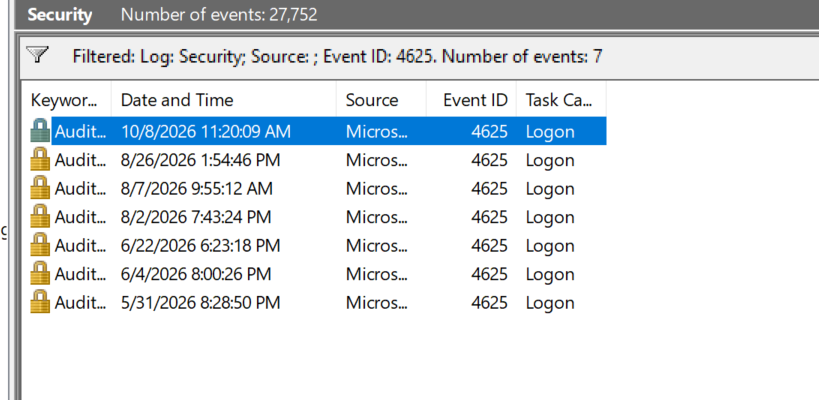
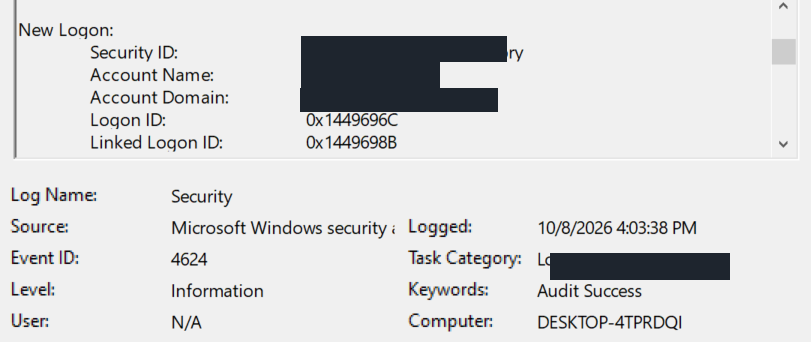

# Windows Security Event Log Analysis

## Overview

This lab demonstrates the use of Windows Event Viewer to investigate authentication activity, analyze successful and failed logon attempts, and identify potential security concerns.

The investigation focuses on Windows Security Event IDs 4624 and 4625, logon types, authentication failure codes, and event correlation.

**Lab Type:** Windows Security Log Analysis  
**Environment:** Windows Operating System  
**Tools:** Windows Event Viewer  
**Focus Area:** Security Monitoring and Incident Investigation

---

## Objectives

- Navigate and analyze Windows Security Event Logs.
- Identify successful and failed authentication attempts.
- Understand Windows Event IDs 4624 and 4625.
- Differentiate interactive and service logons.
- Interpret authentication failure codes.
- Filter security events using XML queries.
- Correlate authentication events using timestamps and account information.
- Document findings and assess potential security concerns.

---

## Tools and Technologies

| Tool | Purpose |
|------|---------|
| Windows Event Viewer | Review Windows security events |
| Windows Security Logs | Investigate authentication activity |
| XML Queries | Filter events based on specific criteria |
| Windows Event IDs | Identify authentication events |
| Windows Logon Types | Determine authentication methods |

---

## Windows Security Event IDs

The following Event IDs were examined during the investigation.

| Event ID | Description |
|----------|-------------|
| 4624 | An account was successfully logged on |
| 4625 | An account failed to log on |

### Windows Logon Types

| Logon Type | Description |
|------------|-------------|
| 2 | Interactive logon, typically a local computer sign-in |
| 5 | Service logon, typically used by Windows services |

Understanding these differences helps distinguish user authentication activity from operating system processes.

---

## Investigation Methodology

### Step 1: Access Windows Security Logs

1. Press `Windows + R`.
2. Enter `eventvwr.msc`.
3. Navigate to `Windows Logs > Security`.
4. Review available security events.

The Security log contained approximately 27,752 events at the time of the initial review.

### Step 2: Identify Failed Logon Attempts

Using the Filter Current Log feature, I filtered the Security log for:

`4625`

The filter returned seven recorded failed logon events spanning May through October 2026.

The most recent failed logon occurred on October 8, 2026, at 11:20:09 AM.

**Evidence:**



### Step 3: Investigate the Failed Logon

I opened the October 8 Event ID 4625 and reviewed the authentication details.

| Field | Observed Value |
|-------|----------------|
| Event ID | 4625 |
| Date | October 8, 2026 |
| Time | 11:20:09 AM |
| Account Name | [REDACTED USERNAME] |
| Account Domain | [REDACTED COMPUTER NAME] |
| Logon Type | 2 |
| Failure Reason | %%2313 |
| Status | 0xC000006D |
| Sub Status | 0xC000006A |
| Source Network Address | - |

#### Authentication Failure Analysis

**Status: `0xC000006D`**

Indicates a logon failure associated with invalid authentication credentials.

**Sub Status: `0xC000006A`**

Indicates an incorrect password for the specified account.

**Logon Type: `2`**

Indicates an interactive logon attempt, typically associated with signing in directly to the computer.

**Source Network Address: `-`**

No source network address was recorded in the event.

These findings are consistent with an unsuccessful interactive authentication attempt caused by an incorrect password.

The event alone does not establish who initiated the attempt.

**Evidence:**


---

### Step 4: Investigate Successful Logons

I filtered the Windows Security log for:

`4624`

Several successful authentication events were recorded on October 8, 2026.

An event at 11:21:21 AM showed:

| Field | Observed Value |
|-------|----------------|
| Event ID | 4624 |
| Time | 11:21:21 AM |
| Account Name | SYSTEM |
| Logon Type | 5 |
| Result | Successful logon |

Logon Type 5 represents a service logon.

This event involved the Windows SYSTEM account and did not establish that the personal user account successfully authenticated after the earlier failure.

**Evidence:**


---

### Step 5: Filter Interactive Logons Using XML

To narrow the investigation, I used an XML query to display successful interactive logons.

In Event Viewer:

1. Navigate to `Windows Logs > Security`.
2. Select `Filter Current Log`.
3. Open the `XML` tab.
4. Enable `Edit query manually`.
5. Enter the following query.

```xml
<QueryList>
  <Query Id="0" Path="Security">
    <Select Path="Security">
      *[System[(EventID=4624)]]
      and
      *[EventData[Data[@Name='LogonType']='2']]
    </Select>
  </Query>
</QueryList>
```

This query selects events matching:

- Event ID 4624: Successful authentication.
- Logon Type 2: Interactive logon.

The filter returned four successful interactive logon events on October 8, 2026.

**Evidence:**


---

### Step 6: Verify the Successful User Logon

I examined the `New Logon` section of a successful interactive authentication event.

The event at 4:03:38 PM contained:

| Field | Observed Value |
|-------|----------------|
| Event ID | 4624 |
| Date | October 8, 2026 |
| Time | 4:03:38 PM |
| Account Name | [REDACTED USERNAME] |
| Account Domain | [REDACTED COMPUTER NAME] |
| Logon Type | 2 |
| Result | Successful authentication |

This confirmed that the personal Windows account successfully authenticated later that day.

However, the successful authentication occurred several hours after the failed attempt. A direct relationship between these events could not be established.

**Evidence:**



---

## Authentication Event Timeline

The following events were identified on October 8, 2026.

| Time | Event ID | Logon Type | Observation |
|------|----------|------------|-------------|
| 10:56:08 AM | 4624 | 2 | Two successful interactive logon events; account identities not verified |
| 11:20:09 AM | 4625 | 2 | Failed authentication for the personal account due to an incorrect password |
| 11:21:21 AM | 4624 | 5 | Successful SYSTEM service logon |
| 4:03:38 PM | 4624 | 2 | Two successful interactive logon events; personal account verified in one |

The timestamps were compared to determine whether the failed authentication was followed by a related successful login.

The SYSTEM service logon was not considered confirmation of a successful personal account login.

---

## Findings

### 1. Failed Authentication Identified

A failed interactive logon occurred on October 8, 2026, at 11:20:09 AM.

The authentication failure codes indicated an incorrect password.

### 2. Limited Failed Logon Activity

Seven failed logon events were present in the reviewed Security log, distributed across several months.

The available records did not show a concentrated sequence of repeated failed authentication attempts around the investigated event.

### 3. Windows Service Activity Identified

A successful SYSTEM logon with Logon Type 5 occurred shortly after the failed authentication.

This was classified as service logon activity rather than evidence of a successful personal account login.

### 4. Successful Interactive Authentication Confirmed

A successful interactive logon for the personal account was identified at 4:03:38 PM.

The time difference prevented confirmation that it was directly associated with the earlier failed attempt.

### 5. No Confirmed Malicious Activity

The reviewed events did not establish evidence of a brute-force attack, account compromise, or other malicious authentication activity.

The failed logon was consistent with an incorrect password attempt.

---

## Investigation Limitations

- The investigation was limited to the available local Windows Security Logs.
- The source of the failed authentication could not be definitively identified.
- A missing source network address did not establish the identity or physical location of the person initiating the attempt.
- The successful logon at 4:03:38 PM could not be directly correlated with the 11:20:09 AM failure.
- The investigation primarily examined Event IDs 4624 and 4625.
- Other authentication mechanisms and event sources were not fully investigated.
- No malware analysis, endpoint detection, or network traffic investigation was performed.

---

## Conclusion

This lab provided hands-on experience investigating Windows authentication events using Event Viewer.

The investigation identified a failed interactive logon caused by an incorrect password, examined subsequent SYSTEM service activity, and confirmed a successful interactive logon to the personal account later that day.

**Final Assessment: No confirmed malicious activity identified in the reviewed events.**

This conclusion is limited to the available evidence and does not establish that the system is free from security threats.

The investigation demonstrated the importance of examining account information, logon types, failure codes, and timestamps before determining whether authentication activity is suspicious.

---

## Skills Practiced

- Windows Event Log Analysis
- Security Event Monitoring
- Authentication Log Investigation
- Windows Event ID Interpretation
- Logon Type Analysis
- XML Event Filtering
- Event Timeline Correlation
- Basic Security Incident Investigation
- Evidence Documentation
- SOC Analyst Investigation Fundamentals

---

## Key Takeaways

- Event ID 4624 records successful logons.
- Event ID 4625 records failed logons.
- Logon Type 2 represents interactive authentication.
- Logon Type 5 represents service authentication.
- Authentication failure codes provide additional context about unsuccessful login attempts.
- Successful and failed logons should not be assumed related based only on their timestamps.
- Security findings must be supported by available evidence.

---

## Screenshots

All screenshots used in this lab should have personal account names, computer names, and other identifying information redacted before publication.

Screenshots are stored in the `screenshots` directory.

---

## Lab Status

**Completed — Windows Security Event Log Analysis**

**Next Learning Objective:** Explore Windows authentication log analysis using a Security Information and Event Management (SIEM) platform such as Splunk.
